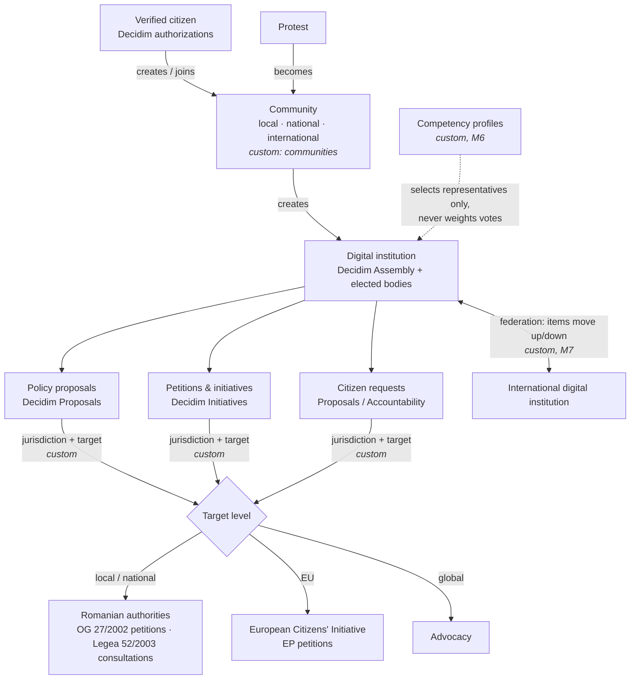

# Architecture

digidemocracy.ro = **Decidim (reused as much as possible) + a bottom-up governance layer (custom modules)**.
Target Decidim version: **0.32.x** (latest release at time of writing: v0.32.2, Oct 27, 2026; Ruby 3.4, Rails 8.1, Node ≥ 22).

## Concept mapping: white paper → Decidim

| White paper concept | Decidim building block | Status |
|---|---|---|
| Citizen identity / verification | Authorizations (verification handlers) | Reuse; add RO handler (SMS/document, later ROeID) — M1 |
| Communities c1…cn (local, national, international) | User groups (`decidim-core`) as base | **Custom** `decidim-module-communities` — M2 |
| Digital institutions i1…in | Assemblies (`decidim-assemblies`), incl. members and child assemblies | Reuse + custom link community → institution — M3 |
| Policy proposals list | Proposals (`decidim-proposals`) | Reuse — M3 |
| Petitions / public initiatives lists | Initiatives (`decidim-initiatives`), signatures | Reuse — M3 |
| Citizen requests tracked by stage | Proposals with states / Accountability (`decidim-accountability`) | Reuse — M3 |
| Discussions | Debates, Comments (`decidim-debates`, `decidim-comments`) | Reuse |
| Events, protest planning | Meetings (`decidim-meetings`) | Reuse |
| Polls inside communities | Surveys (`decidim-surveys`) | Reuse |
| Consultative votes / referendums | Elections (`decidim-elections`) | Reuse — M8 |
| Notifications, follows, search | `decidim-core` | Reuse |
| Jurisdiction level + target on each list item | — | **Custom** (metadata on list items) — M3 |
| Formal submission to Romanian authorities (OG 27/2002, Legea 52/2003), deadline tracking | — | **Custom** `decidim-module-state-link` (planned) — M4 |
| Protest → community → institution | Meetings + communities + assemblies | **Custom** flow — M5 |
| Competency certification & ranking (representatives only) | — | **Custom** `decidim-module-competencies` (planned) — M6 |
| International federation (lists move up/down between levels) | — | **Custom** (planned) — M7 |
| Economic layer (sponsored events, media, marketplace) | — | **Out of this repo**, separate commercial entity — M8 |

## Bottom-up flow

## Key rules (to be enforced in code)

1. **Voting eligibility follows the target's jurisdiction.** For an item addressed to the Romanian Government, only members eligible in Romania vote, even inside an international community.
2. **One person, one vote.** Competency ranking is used only to select representatives and experts; its algorithm is published and auditable.
3. **Link to state institutions requires a local or national community** (white paper rule); international institutions pass decisions down to national institutions, which address their own authorities.
4. **Legal effect is limited to existing channels.** Petitions (OG 27/2002) and consultations (Legea 52/2003) have legal effect today; electronic votes/referendums are consultative only under current Romanian law.
5. **GDPR:** political opinions and community membership are special-category data (Art. 9). Data minimisation; separate votes from identity where possible.

## Custom modules

| Module | Milestone | State |
|---|---|---|
| `decidim-module-communities` | M2 | Skeleton in this repo |
| jurisdiction/target metadata for lists | M3 | Planned |
| `decidim-module-state-link` | M4 | Planned |
| protest flow | M5 | Planned |
| `decidim-module-competencies` | M6 | Planned |
| federation | M7 | Planned |

Module names other than `communities` are provisional.
